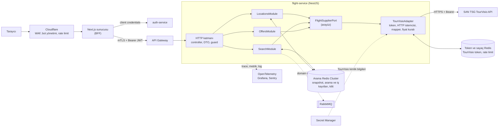
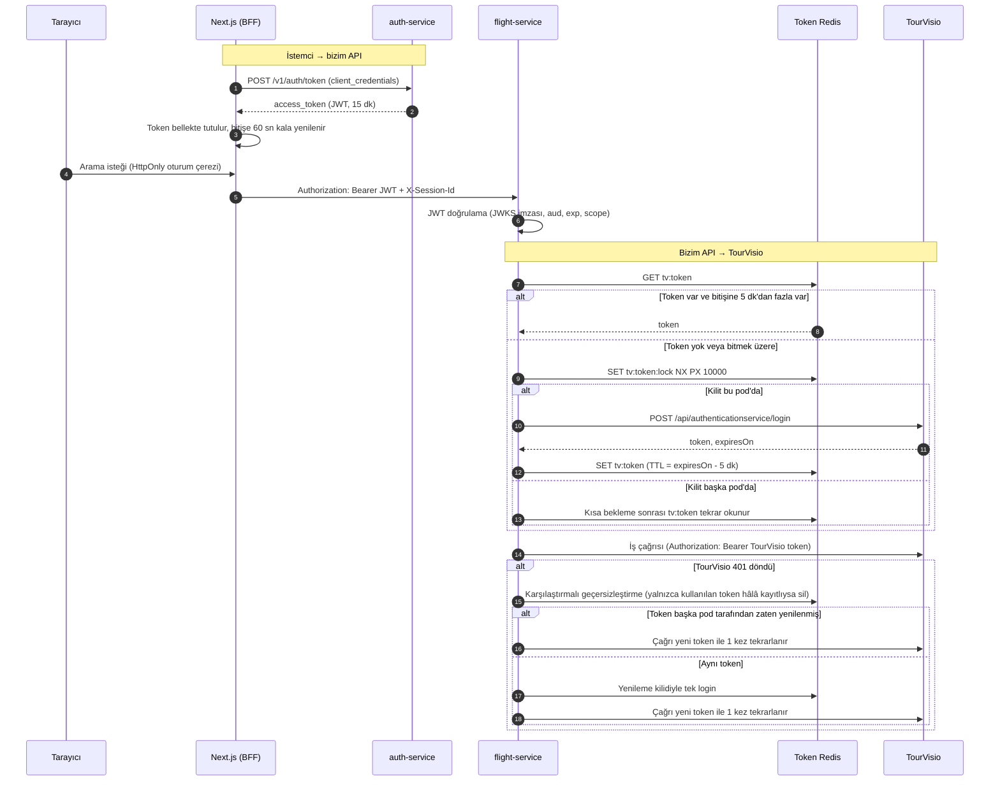
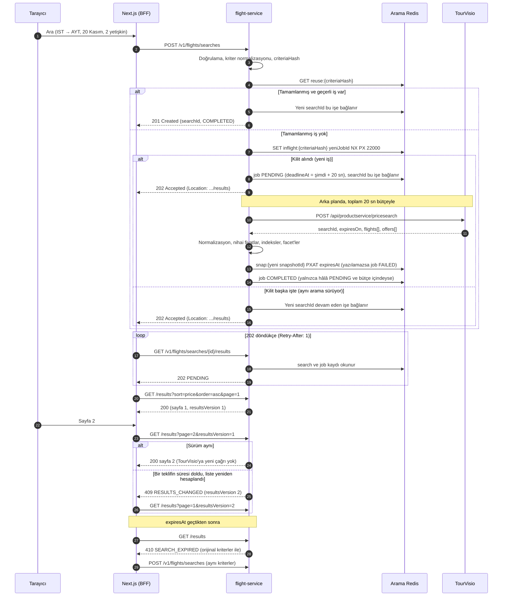

# gidiyorum.com · TourVisio Uçak API Mimari Planı

**Hazırlayan:** Ozan Alpkaya  
**Tarih:** 12 Ekim 2026  
**Kapsam:** Auth, lokasyon arama, uçuş arama, listeleme ve teklif detayı

**Durum:** Plan yalnızca dokümantasyona dayanmaktadır. Test hesabı bulunmadığından TourVisio’ya canlı çağrı yapılmamıştır. Doğrulanamayan noktalar varsayım veya açık soru olarak belirtilmiştir.

**Ekler:** [API sözleşmesi ve örnek JSON’lar](docs/api-contract.md) · [TourVisio eşlemesi ve fiyat kuralları](docs/tourvisio-mapping.md) · [Tasarım ayrıntıları](docs/design-details.md)

## Özet

- Next.js, TourVisio'ya hiç bağlanmaz. Tarayıcı yalnızca Next.js sunucusuyla (BFF) konuşur; BFF, `flight-service`'e sunucudan sunucuya bağlanır.
- `flight-service` tek deploy edilen bir NestJS servisidir. TourVisio'ya özgü her şey `TourVisioAdapter` modülündedir; dışarıya TourVisio alan adı, enum değeri veya ID'si sızmaz.
- Arama sonucu tek bir TourVisio çağrısıyla alınır ve Redis'te TTL'li bir snapshot olarak saklanır. Sayfalama, filtre ve sıralama bu snapshot'tan yapılır; TourVisio'ya yeniden gidilmez.
- Darboğaz TourVisio'dur (2–8 sn yanıt, kota). Birleştirme, cache, eşzamanlılık sınırı, timeout ve circuit breaker bu yüzden adaptör katmanındadır.
- Rezervasyon ve ödeme kapsam dışıdır; ileride ayrı bir `booking-service`, bu plandaki `searchId`/`offerId` sözleşmesini girdi alıp TourVisio `BeginTransaction` → `SetReservationInfo` → ödeme → `CommitTransaction` adımlarını saga olarak yönetecektir.

## İçindekiler

1. [Teknoloji seçimi](#1-teknoloji-seçimi)
2. [Mimari şema](#2-mimari-şema)
3. [Metot planı](#3-metot-planı)
4. [Auth ve listeleme akışı](#4-auth-ve-listeleme-akışı)
5. [Sisteme erişim](#5-sisteme-erişim)
6. [Güvenlik](#6-güvenlik)
7. [Ölçekleme](#7-ölçekleme)
8. [Varsayımlar](#varsayımlar)
9. [TourVisio'ya açık sorular](#tourvisioya-açık-sorular)
10. [Süre ve yapay zekâ kullanımı](#süre-ve-yapay-zekâ-kullanımı)

---

## 1. Teknoloji seçimi

| Katman | Seçim | Gerekçe |
|---|---|---|
| Dil ve framework | Node.js 22 LTS, TypeScript, NestJS | İş ilanındaki teknoloji yığınıyla uyumlu. Modül ve DI yapısı adaptörü arayüz arkasına almayı kolaylaştırır; I/O ağırlıklı iş yüküne (2–8 sn bekleyen dış çağrılar) uygun |
| Cache ve arama deposu | İki Redis: arama Cluster'ı ve token/sayaç örneği | Arama verisi (snapshot, arama ve iş kayıtları, kilitler, lokasyon cache'i) ayrı Cluster'da; TourVisio token'ı ve rate limit sayaçları ayrı küçük örnekte, böylece arama verisinin bellek baskısından etkilenmez. Pod'lar stateless kalır |
| Veritabanı | Arama akışında yok; rezervasyon fazında PostgreSQL | Arama verisi geçicidir ve sağlayıcıdan yeniden üretilebilir. Rezervasyon ve ödeme ACID ister |
| Kuyruk | RabbitMQ, kritik yolun dışında | Kullanıcının beklediği aramaya kuyruk gecikme ekler. Domain event'leri (analitik) ve ileride booking saga'sı için |
| HTTP istemcisi ve dayanıklılık | undici (keep-alive havuzu), opossum (circuit breaker) | Yüzlerce eşzamanlı TourVisio çağrısında bağlantı yeniden kullanımı ve hata izolasyonu |
| API sözleşmesi | OpenAPI 3.1, hatalar RFC 9457 Problem Details | Next.js, mobil ve B2B istemcileri aynı sözleşmeden tip üretir |
| Gözlemlenebilirlik | OpenTelemetry, Prometheus, Grafana, Sentry | TourVisio `requestId` değeri trace'e eklenir |
| Edge ve çalışma ortamı | Cloudflare; Docker, Kubernetes (HPA) | WAF, bot yönetimi, edge cache; yatay ölçekleme |

## 2. Mimari şema



**Karar: Tek servis (`flight-service`), içinde net modül sınırları.**

- Lokasyon, arama, listeleme ve teklif detayı aynı veriyi (snapshot) ve aynı sağlayıcıyı kullanır. Ayrı servisler yalnızca ağ adımı ve dağıtık durum ekler.
- Sınır servis değil arayüz düzeyinde: `FlightSupplierPort`. İkinci bir sağlayıcı yeni bir adaptörle eklenir; API sözleşmesi değişmez.
- Ayrıştırma tetikleyicileri: TourVisio otel veya otobüste de kullanılırsa token ve kota ortak bir `supplier-gateway`'e taşınır (kota tek hesaba aittir). Arama trafiği diğer modüllerden çok farklı ölçeklenirse `SearchModule` ayrı deploy edilir.
- Kimlik doğrulama, iş ilanındaki mikroservis listesinde yer alan auth servisinde (`auth-service`) kalır; `flight-service` yalnızca JWT doğrular.

**TourVisio adaptörünün sorumlulukları** (ayrıntı: [eşleme dokümanı](docs/tourvisio-mapping.md))

- **Enum dönüşümü:** Autocomplete yanıtındaki tip ile arama isteğindeki tip farklı enum'lardır (şehir `1` → `2`, havalimanı `3` → `5`). İstemci yalnızca `AIRPORT:SAW` gibi kendi ID'lerimizi görür.
- **Hata tespiti:** HTTP kodunun yanında `header.success=false` ve `messageType=1` de hata sayılır.
- **Fiyat:** Gösterilen her fiyat, TourVisio'nun [toplam fiyat kuralına](docs/tourvisio-mapping.md#toplam-fiyat-hesaplama) göre hesaplanmış nihai tutardır (paketli teklif, ücret anahtarları). Bunun için aramada `calculateFlightFees: true` gönderilir. `fees` alanı dönmeyen teklifin ücreti bilinmediği için bu teklif listelenmez; yanlış düşük fiyat gösterilmez ([açık soru 12](#tourvisioya-açık-sorular)).
- **Normalizasyon:** Para decimal string, uçuş saatleri yerel saat ([açık soru 5](#tourvisioya-açık-sorular)); ham yanıt dışarı verilmez. TourVisio `header.requestId` her çağrıda loglanır.

## 3. Metot planı

Tüm endpoint'ler `/v1` altındadır. Modeller ve tam örnekler: [api-contract.md](docs/api-contract.md).

| Metot | Endpoint | Girdi | Çıktı | TourVisio çağrısı | Cache | Hatalar (HTTP) |
|---|---|---|---|---|---|---|
| **Auth** (istemci → bizim API) | `POST /v1/auth/token`<br>(`auth-service`) | `grant_type=client_credentials`, `client_id`, `client_secret` | `access_token` (JWT), `expires_in: 900`, `scope` | Yok | BFF belleğinde, bitişe 60 sn kala yenilenir | 400 `invalid_request`<br>401 `invalid_client`<br>429 |
| **Auth** (bizim API → TourVisio) | İç işlem | Agency, User, Password (Secret Manager) | Token, `expiresOn` | `POST /api/authenticationservice/login` | Redis, TTL = `expiresOn` − 5 dk | Login başarısızsa 503 `SUPPLIER_UNAVAILABLE` + alarm |
| **Kalkış lokasyonu** | `GET /v1/flights/locations/departures` | `q` (en az 2 karakter), `tripType` | `items[]`: `id`, `type`, `code`, `name` | `POST /api/productservice/getdepartureautocomplete` | Redis 24 sa + edge 1 sa | 400<br>429<br>503 (varsa bayat cache döner) |
| **Varış lokasyonu** | `GET /v1/flights/locations/arrivals` | Yukarıdakiler + `from` (seçilen kalkış) | Aynı | `POST /api/productservice/getarrivalautocomplete` | Aynı; anahtarda `from` var | Yukarıdakiler |
| **Uçuş arama** | `POST /v1/flights/searches` | `tripType`, `origin`, `destination`, `departureDate`, `returnDate`, `passengers`, `cabin`, `currency` | 201 (hazır) / 202 (bekliyor): `searchId`, `status`; `Location: .../{searchId}/results` | `POST /api/productservice/pricesearch` veya `flightpricesearch` | İş bütçesi 20 sn. Sonucun sabit bitişi: min(`expiresOn` − 60 sn, tamamlanma + 15 dk). Arama ve iş kaydı 2 sa | 400 şema<br>422 iş kuralı (geçmiş tarih, bebek > yetişkin, yolcu > 9)<br>429<br>503 (sağlayıcı veya arama deposu erişilemez) |
| **Listeleme** | `GET /v1/flights/searches/{searchId}/results` | `page`, `pageSize` (≤ 50), `sort` (fiyat, süre, saat), `order`, `airlines`, `stops`, `departureFrom/To`, `resultsVersion`; gidiş-dönüşte `leg`, `outboundOfferId` | `status`, `resultsVersion`, `items[]` (uçuş başına seçilebilir teklifler), `facets`, sayfa bilgisi, `expiresAt` | **Yok**, snapshot'tan | Snapshot | 202 bekliyor (`Retry-After: 1`)<br>404<br>409 `RESULTS_CHANGED`<br>410 `SEARCH_EXPIRED`<br>502 / 503 / 504 arama başarısız |
| **Teklif detayı** | `GET /v1/flights/searches/{searchId}/offers/{offerId}` | Path; gidiş-dönüşte `inboundOfferId`; "Devam" adımında `refresh=true` | Segmentler, bagaj, marka, hizmetler, fiyat kırılımı, kalan koltuk, `priceVerified` | Varsayılan: yok (snapshot). `refresh=true`: opsiyonel `POST /api/productservice/getoffers`. Kural metni (`getfarerules`) `transactionId` istediği için rezervasyon adımında | Snapshot | 404<br>410 `OFFER_EXPIRED` |

**Ortak:** 401 `UNAUTHORIZED`, 403 `FORBIDDEN`, 500. Uçuş bulunamaması hata değildir (200, boş liste). TourVisio hatası 502, zaman aşımı 504, circuit açık veya kota dolu 503 + `Retry-After` döner; istemci "tekrar dene" ile "kriteri değiştir" mesajını bu ayrımdan seçer.

**Önemli kararlar**

- **Arama asenkron (202 + polling):** TourVisio 2–8 sn sürer. Sayfa yenileme veya çift tıklama yeni bir TourVisio çağrısı yaratmaz; aynı arama sürüyorsa yeni istek o işe bağlanır.
- **Sürümlü sonuç:** Teklifler tek tek dolabildiği için sonuç kümesi zamanla değişebilir. Her yanıt bir `resultsVersion` taşır. Sürüm değiştiyse sayfa kaydırılmaz, 409 döner ve liste birinci sayfadan yeniden yüklenir. Böylece hiçbir uçuş atlanmaz veya iki kez gösterilmez.
- **Uçuş başına tüm teklifler:** Listedeki her uçuş, seçilebilir tüm marka/paket tekliflerini (`offers[]`) fiyata göre sıralı taşır. Gidiş-dönüşte ilk teklif, `fromTotal` değerini sağlayan tekliftir; bu teklif en ucuz gidiş teklifi olmayabilir.
- **Opak ID'ler:** `searchId` ve `offerId` bizim ürettiğimiz değerlerdir. TourVisio'nun ID'leri yalnızca snapshot'ta tutulur.
- **Gidiş-dönüş iki adımlı listelenir** (dokümandaki örnek kodla aynı mantık): önce gidişler, her biri uyumlu dönüşlerle oluşabilecek en düşük nihai toplamla (`fromTotal`); gidiş seçilince yalnızca `groupKeys` kesişimi olan dönüşler, çiftin nihai toplamıyla.
- **`getoffers` yalnızca "Devam" adımında çağrılır.** Her detay görüntülemede çağırmak kotayı tüketir. Metodun güncel fiyat döndürüp döndürmediği teyit edilecek ([açık soru 9](#tourvisioya-açık-sorular)). Fiyat değiştiyse `priceChanged: true` döner. Çağrı başarısız olursa snapshot fiyatı `priceVerified: false` ile döner ve kullanıcı yolcu bilgisi adımına geçebilir; çünkü bu adımda para çekilmez. Ödeme öncesi son fiyat kontrolü rezervasyon fazındaki `BeginTransaction` yanıtıyla yapılır; fark varsa kullanıcıya yeni fiyat gösterilip onayı alınır. Bu fiyatın ne kadar süre garanti edildiği SAN TSG'ye sorulacak ([açık soru 8](#tourvisioya-açık-sorular)).

## 4. Auth ve listeleme akışı

### 4.1 Auth

İki ayrı token vardır ve birbirine karışmaz. Bizim JWT'miz istemci ile `flight-service` arasında kullanılır. TourVisio token'ı `flight-service` ile TourVisio arasında kullanılır ve servis dışına hiç çıkmaz.



- **Bizim JWT:** RS256 ile imzalı, 15 dk geçerli, `aud` ve `scope` ile sınırlı. Yalnızca BFF belleğinde durur. Süresi dolunca yenisi alınır; client credentials akışında refresh token gerekmez.
- **TourVisio token'ı:** Redis'te tüm pod'larca paylaşılır. `expiresOn`'dan 5 dk önce, dağıtık kilitle tek pod tarafından yenilenir. 401'de token koşulsuz silinmez: yalnızca başarısız çağrıda kullanılan token hâlâ kayıtlıysa geçersizleştirilir. Böylece gecikmiş bir 401, başka bir pod'un yeni aldığı token'ı silemez. Login sürekli başarısız olursa circuit açılır ve alarm üretilir.

### 4.2 Listeleme



- **Üç ayrı kimlik:** `searchId` istemcinin isteğidir, `jobId` tek bir TourVisio çağrısıdır, `snapshotId` o çağrının sonucudur. Kriter hash'i yalnızca bir isteği mevcut bir işle eşleştirir; sonuç anahtarı değildir. Böylece aynı kriterle sonradan yapılan bir arama, eski aramanın sonucunun üzerine yazamaz.
- **Okuma durum sırasıyla yapılır:** Önce sahiplik kontrol edilir, sonra iş durumu, en son geçerlilik süresi. `PENDING` → 202; `FAILED` veya bütçe aşılmış → 502/503/504; süre dolmuş → 410; geçerli → 200. "Snapshot yok" tek başına "süre doldu" sayılmaz ([durum tablosu](docs/design-details.md#listeleme-okuması-get-results)).
- **Süre bütçesi:** Login, denemeler, retry beklemesi ve normalizasyon tek bir 20 sn'lik bütçeye dahildir. Retry yalnızca bütçede yeterli süre kaldıysa başlar. Bütçe aşıldıktan sonra gelen geç sonuç yayımlanmaz.
- **Sayfalama ve filtre:** Snapshot belleğe alınır, filtrelenir, önceden hesaplanmış indeksle sıralanır ve dilimlenir. TourVisio yanıtı zaten sayfalı değildir. Facet'ler filtrelenmemiş kümeden hesaplanır.
- **`expiresOn` ve süre dolması:** Sonucun bitiş anı iş tamamlanırken bir kez belirlenir ve Redis'e mutlak zamanla (`PXAT`) yazılır; yeniden hesaplama bu anı uzatmaz. Arama kaydı 2 sa yaşar: bu sürede 410 + orijinal kriterler, sonra 404 döner. İki durumda da Next.js aynı kriterlerle yeniden arar.
- **Paylaşım:** Varsayılan olarak bir iş yalnızca aynı oturumda yeniden kullanılır. SAN TSG izin verirse ([açık soru 16](#tourvisioya-açık-sorular)) oturumlar arası paylaşım konfigürasyonla açılır.
- **Redis kesintisi:** Sözleşme değişmez; arama 503 `SEARCH_UNAVAILABLE` + `Retry-After` döner. Ayrıntı: [tasarım ayrıntıları](docs/design-details.md#2-arama-yaşam-döngüsü).

**Örnek: arama isteği ve listeleme yanıtı** (kısaltılmış; tüm örnekler [api-contract.md](docs/api-contract.md))

```json
{
  "tripType": "ONE_WAY",
  "origin": "CITY:IST",
  "destination": "AIRPORT:AYT",
  "departureDate": "2026-11-20",
  "passengers": { "adults": 2, "children": 0, "infants": 0 },
  "cabin": "ECONOMY",
  "currency": "TRY"
}
```

`GET /v1/flights/searches/3f6c1e8a-.../results?sort=price&order=asc&stops=0&page=1&pageSize=20`

```json
{
  "searchId": "3f6c1e8a-9b2d-4f7e-8a51-2c0d9e4b7a13",
  "status": "COMPLETED",
  "expiresAt": "2026-10-13T09:29:00Z",
  "resultsVersion": 1,
  "page": 1,
  "pageSize": 20,
  "totalItems": 41,
  "totalPages": 3,
  "items": [
    {
      "flightId": "fl_2c9e71a04b",
      "departure": { "airport": "SAW", "localTime": "2026-11-20T09:35:00" },
      "arrival": { "airport": "AYT", "localTime": "2026-11-20T10:50:00" },
      "durationMinutes": 75,
      "stops": 0,
      "airline": { "code": "PC", "name": "Pegasus" },
      "lowestPrice": { "amount": "3890.00", "currency": "TRY" },
      "offers": [
        { "offerId": "of_8c1f2a9d4e", "brand": "Basic", "price": { "amount": "3890.00", "currency": "TRY" } },
        { "offerId": "of_8c1f2a9d4f", "brand": "Essentials", "price": { "amount": "4620.00", "currency": "TRY" } },
        { "offerId": "of_8c1f2a9d50", "brand": "Advantage", "price": { "amount": "5480.00", "currency": "TRY" } }
      ]
    }
  ],
  "facets": {
    "airlines": [
      { "code": "PC", "name": "Pegasus", "count": 22, "minPrice": { "amount": "3890.00", "currency": "TRY" } },
      { "code": "TK", "name": "Turkish Airlines", "count": 19, "minPrice": { "amount": "4310.00", "currency": "TRY" } }
    ],
    "stops": [{ "value": 0, "count": 41 }]
  }
}
```

## 5. Sisteme erişim

**Karar: Next.js, servise kendi sunucusundan (BFF) bağlanır, tarayıcıdan değil.**

- `client_secret` ve JWT tarayıcıya hiç inmez; CORS yüzeyi oluşmaz; ilk sayfa SSR ile render edilebilir.
- Tarayıcı ile BFF arasında HttpOnly, Secure, SameSite=Lax bir oturum çerezi kullanılır; `POST` uçlarında `Origin` kontrolüyle CSRF koruması vardır.
- BFF, oturum kimliğini `X-Session-Id` başlığıyla iletir ve `searchId` sahipliği bu kimliğe bağlanır. Gateway bu başlığı yalnızca mTLS ile gelen BFF isteklerinde kabul eder.

| İstemci | Erişim modeli |
|---|---|
| Web (Next.js) | BFF + OAuth2 client credentials |
| Mobil uygulama | Secret gömülemez. Anonim aramada App Attest / Play Integrity ile kısa ömürlü token; giriş yapan kullanıcıda Authorization Code + PKCE. Ayrı `client_id` ve rate limit |
| B2B acente | Acente başına client credentials (ileride mTLS), token'da `tenantId`, acenteye özel scope ve kota; ayrı API ürünü (`/partner/v1`) olabilir |

**Secret'lar:** TourVisio kimlik bilgileri, JWT imzalama anahtarı ve Redis parolası Secret Manager'da tutulur ve External Secrets ile pod'lara aktarılır. Repoda, image'da ve loglarda bulunmaz. Her ortam için ayrı TourVisio kullanıcısı vardır; periyodik rotasyon yapılır; loglarda token ve parolalar maskelenir.

## 6. Güvenlik

| Tehdit | Önlem |
|---|---|
| Bot ve scraping | Cloudflare bot yönetimi, şüpheli trafikte Turnstile; IP, oturum ve ASN bazlı rate limit; arama yalnızca geçerli BFF oturumuyla; kriter sınırları (en fazla 330 gün ileri, en fazla 9 yolcu); tekrar eden aramalar cache'ten döner |
| TourVisio kotasının tükenmesi | Redis'te global dakikalık çağrı bütçesi; birleştirme; istemci bazlı kota; `getoffers` yalnızca "Devam" adımında; %80'de alarm; bütçe dolunca önce cache, yoksa 503 + `Retry-After` |
| Token sızıntısı | TourVisio token'ı servis dışına çıkmaz; JWT 15 dk, `aud`/`scope` sınırlı, yalnızca BFF belleğinde; TLS; log maskeleme; şüphede rotasyon |
| Başkasının `searchId`'sine erişim | `searchId` tahmin edilemez bir UUIDv4'tür, TourVisio ID'si değildir; istemci ve oturuma bağlıdır; eşleşmezse 404 döner (varlığı sızdırmamak için 403 değil); `offerId` yalnızca kendi araması altında çözülür |
| Girdi manipülasyonu | DTO whitelist, sayısal sınırlar, IATA kod formatı kontrolü, gövde boyutu sınırı; fiyat istemciden asla alınmaz |

**KVKK (ileride TCKN ve pasaport):** Yalnızca zorunlu alanlar toplanır. Bu alanlar KMS ile alan düzeyinde şifrelenir; erişim rol bazlıdır ve audit log'a yazılır. Log, trace ve Sentry'de kişisel veri bulunmaz. Saklama süresi sonunda veri silinir veya anonimleştirilir. SAN TSG ile veri işleyen sözleşmesi yapılır ve yurt dışına aktarım değerlendirilir ([ayrıntı](docs/design-details.md#6-kvkk-ileride-yolcu-verisi)).

## 7. Ölçekleme

**Kapasite hesabı**

- 3.000 arama/dk = 50 arama/sn. Little yasasına göre eşzamanlı TourVisio çağrısı ≈ 50 × 5 sn ≈ **250**; 8 sn'de ≈ **400**.
- Paylaşım kapalıyken (varsayılan) bu değerler üst sınırdır. Oturumlar arası paylaşım açılırsa ve isabet %40 olursa TourVisio'ya giden yük ≈ 30 arama/sn'ye iner.
- Bizim tarafımızda CPU yükü düşüktür; **asıl kısıt TourVisio'nun eşzamanlılık ve kota sınırıdır** ([açık soru 4](#tourvisioya-açık-sorular)).
- Arama Redis'inin bellek bütçesi (duyarlılık hesabı): snapshot'lar 1,1–4,5 GB, 2 saat yaşayan arama ve iş kayıtları ≈ 0,36 GB. Bellek dolarsa sessiz silme olmaz (`noeviction`): yeni aramalar 503 alır. Yeniden hesaplama gerektirmeyen geçerli sonuçlar okunmaya devam eder. Yeniden yazılması gereken sonuçlar ise 503 alır; süresi dolmuş teklif yayımlanmaz ([hesap](docs/design-details.md#5-redis-bellek-tahmini)).

| Konu | Uygulama |
|---|---|
| Stateless ve yatay ölçekleme | Tüm durum Redis'te; HPA, CPU ve "devam eden TourVisio çağrısı" metriğiyle ölçeklenir. TourVisio'ya giden toplam eşzamanlılık, pod sayısından bağımsız global bir limitle sınırlıdır |
| Cache | Lokasyon: arama Redis'i 24 sa + edge 1 sa. Arama: snapshot. TourVisio token'ı ayrı Redis'te |
| Aynı isteklerin birleştirilmesi | Kriter hash'i + `SET NX` kilidi; ilk istek TourVisio işini başlatır, eşzamanlı aynı istekler aynı işe bağlanır, tamamlanmış iş 5 dk boyunca yeniden kullanılır |
| Timeout ve retry | Arama işi toplam 20 sn bütçe, deneme başına en fazla 12 sn; autocomplete 2 sn. Yalnızca bağlantı hatası, 502 ve 503'te ve bütçede en az 5 sn kaldıysa 1 retry (jitter'lı); timeout sonrası arama tekrarlanmaz |
| Circuit breaker ve bulkhead | 30 sn'de %50 hata → açık, 15 sn sonra yarı açık. Autocomplete, arama ve `getoffers` için ayrı havuz ve limit |

**İzlenen metrikler:** TourVisio gecikmesi (p50/p95/p99), hata ve timeout oranı, circuit durumu, kota kullanımı; endpoint bazında RED metrikleri; cache isabeti ve birleştirme oranı; Redis bellek kullanımı; event loop gecikmesi; boş sonuç, 410 ve `priceChanged` oranları. Eşikler, alarmlar ve Redis bellek tahmini: [tasarım ayrıntıları](docs/design-details.md#3-dayanıklılık-parametreleri).

---

## Varsayımlar

1. Arama anonimdir; kullanıcı girişi gerekmez.
2. Varsayılan para birimi TRY, dil `tr-TR`'dir.
3. Uçak için şimdilik tek sağlayıcı TourVisio'dur; sözleşme ikinci bir sağlayıcıya açıktır.
4. Normalize edilip sıkıştırılmış bir snapshot 25–100 KB arasındadır; gerçek boyut test hesabıyla ölçülecek.
5. Next.js ve `flight-service` aynı Kubernetes kümesinde veya özel ağdadır.
6. Çoklu şehir araması (`ServiceType: 3`) kapsam dışıdır; sözleşme `tripType` ile buna açıktır.

## TourVisio'ya açık sorular

**Kalın** yazılan sorular, mimari kararları doğrudan etkileyen ve entegrasyon öncesinde sağlayıcıyla netleştirilmesi gereken konulardır.

1. Token'ın tipik ömrü nedir? Eşzamanlı birden fazla geçerli token olabilir mi?
2. `pricesearch` için dokümanda yazan "Token Required: NO" doğru mu?
3. `pricesearch` ile `flightpricesearch` arasında yanıt ve performans farkı nedir?
4. **Dakikalık arama ve eşzamanlı bağlantı sınırı, look-to-book oranı nedir? Aşılınca ne döner?**
5. **`expiresOn` ve uçuş saatleri UTC mi, yerel mi? (Örneklerde 3 sa 30 dk fark ve tutarsız `Z` eki var.) Bir arama sonucu gerçekte kaç dakika geçerli?**
6. Hatalar HTTP koduyla mı, 200 + `success=false` ile mi dönüyor? `messages[].code` listesi var mı?
7. `groupKeys: "-"` ne anlama geliyor? Paketli gidiş yalnızca paketli dönüşle mi eşleşir? Aynı gün dönüşte `Night: 0` geçerli mi?
8. Rezervasyon başlatmadan `getfarerules` almak mümkün mü? `BeginTransaction`'ın yan etkisi (koltuk bloke, kota) var mı? Döndürdüğü fiyat işlem süresi boyunca garanti mi?
9. **`getoffers` güncel fiyat ve uygunluk döndürüyor mu? Kotaya sayılıyor mu?**
10. Sağlayıcı tarafında sayfalama (`enablePaging`) desteklenen bir senaryo var mı?
11. Teklif `expiresOn` değeri aramanınkinden önce dolabilir mi? Offer Availability `Request` (2) hangi alanla bildiriliyor?
12. **`calculateFlightFees: true` iken `fees` alanının dönmemesi "ücret yok" mu demek? Fiyata vergiler dahil mi?**
13. Veriler hangi ülkede barındırılıyor? Veri işleyen sözleşmesi sağlanıyor mu?
14. Test ve prod adresleri neler? IP whitelist gerekiyor mu?
15. `PROMO` (0) sınıfı ekonomi kabinine mi ait?
16. **Bir arama sonucu farklı son kullanıcılara gösterilebilir mi, yoksa token veya oturuma mı bağlı?**

## Süre ve yapay zekâ kullanımı

- **Harcanan süre:** ~3 saat
- **Yapay zekâ kullanımı:** Claude ve ChatGPT; mimari alternatiflerin değerlendirilmesi, dokümantasyon araştırması, ilk taslağın hazırlanması, Mermaid diyagramları ve JSON örneklerinin oluşturulması ile teknik tutarlılık ve dil kontrollerinde kullanıldı. Taslak, resmî kaynaklarla karşılaştırılarak ve birden fazla inceleme turundan geçirilerek geliştirildi. Kod geliştirilmedi; canlı API testi yapılmadı.
